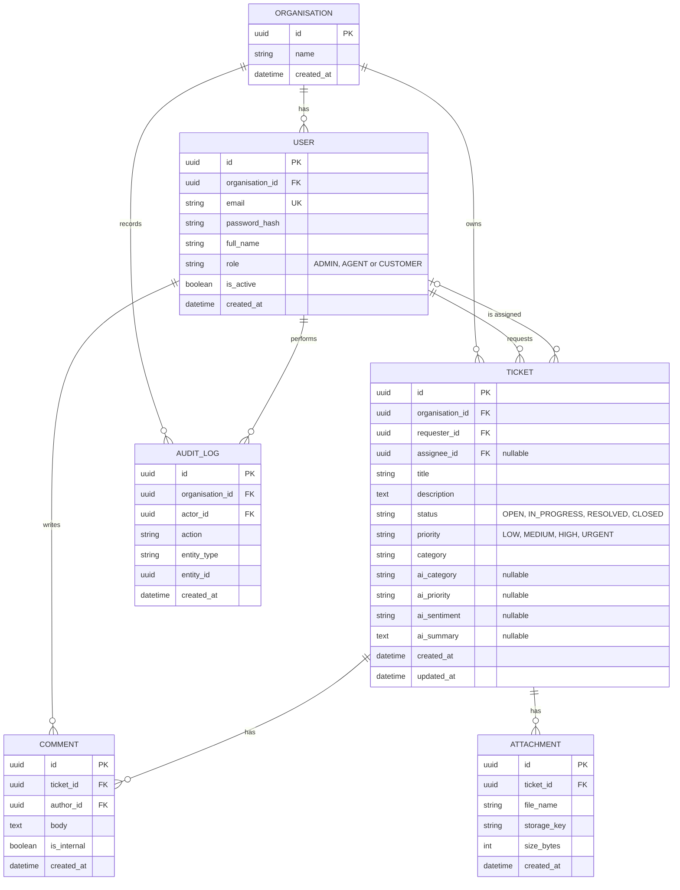

# Database Design (ERD)

## Design notes
- **Multi-tenancy:** every tenant-owned table carries `organisation_id`, and every query filters by it.
- **IDs:** UUIDs, so IDs can't be guessed or counted.
- **AI fields:** stored separately from `category` and `priority`, so an Agent's override never destroys the original AI suggestion.
- **Internal notes:** `is_internal` hides a comment from Customers.